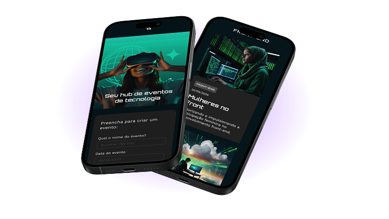

# 📱 Tecboard

**Minha primeira tela desenvolvida em Front-end (HTML e CSS), feita durante o curso da Alura.**

  

---

## 🔗 Link do Projeto

👉 **Veja a página funcionando aqui:** [https://caualb-dev.github.io/tecboard-html/](https://caualb-dev.github.io/tecboard-html/)

  

---

## 📖 Sobre

Este não é um projeto profissional ou comercial — é um **projeto de estudo feito em aula** durante o curso de HTML e CSS da **Alura**. 

Guardei este repositório no portfólio por ter sido a **minha primeira tela criada no Front-end**, onde tive meu primeiro contato prático montando a estrutura de uma página do zero e estilizando para diferentes tamanhos de tela.

---

## 🛠️ O que pratiquei nesta tela

- **HTML5:** Estrutura básica da página (`header`, `main`, `section`), textos, links, imagens e favicon.
- **CSS3:** Cores, espaçamentos, alinhamento de elementos, estilização de botão com efeito `:hover` e importação de fontes locais (`Unbounded` e `Poppins`).
- **Responsividade:** Ajustes básicos de tamanho para telas menores usando `@media` queries.
- **GitHub Pages:** Publicação da página na internet.

---

  Feito por <a href="https://github.com/caualb-dev"><b>Cauã Albuquerque</b></a>

